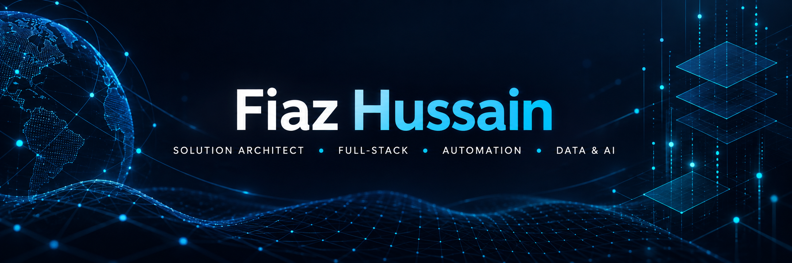

# Fiaz Hussain

**Senior Solution Architect** · web platforms, APIs, automation, and AI

I help clients turn a business problem into software that is ready to use: the product, the integrations, and the deployment. I work remotely from Islamabad.

[Email](mailto:mail.fiazhussain.dev@gmail.com) · [WhatsApp](https://wa.me/923483476760) · [UpForge](https://upforge.us) · [Call](tel:+923483476760)

## What clients hire me for

- Web platforms and responsive product interfaces
- Backend APIs, databases, and multi-tenant systems
- CRM and workflow automation with GoHighLevel, Make, Zapier, and n8n
- Analytics, search, and AI features inside existing products

## Selected work

| Project | What it is |
| --- | --- |
| [Pakufi website](https://github.com/prodeveloperpy-hash/pakufi-website) | Agency website in Next.js |
| [Pakufi CMS](https://github.com/prodeveloperpy-hash/pakufi-cms) | Headless CMS for that website |
| [Butik Music](https://github.com/prodeveloperpy-hash/pakufi-butikmusic) | Artist booking space |
| [Albania Mindful Scene](https://github.com/prodeveloperpy-hash/pakufi-albania-mindful-scene) | Public listing of mindful events |
| [Pakufi analytics](https://github.com/prodeveloperpy-hash/pakufi-analytics) | Self-hosted website analytics |
| [Daftar](https://github.com/prodeveloperpy-hash/daftar-pdf) | Local PDF editor for text and watermarks |
| [QuizOnline](https://github.com/prodeveloperpy-hash/quizonline) | Quiz platform for students, teachers, and admins |
| [CardWise](https://github.com/prodeveloperpy-hash/Altiora-Digital-Labs) | Credit-card discovery and recommendations |

More public code is on the [repositories page](https://github.com/prodeveloperpy-hash?tab=repositories).

## How I work

Requirements, architecture, build, integration, then deployment and support. The usual stack is Python, TypeScript, React, Next.js, Node, PostgreSQL, and cloud hosting on AWS, Google Cloud, or a VPS.

## Experience

**Senior Solution Architect, UpForge** · July 2026 – present  
Architecture for SaaS, automation, and AI products. APIs, databases, and third-party integrations through to production.

**Backend Engineer, UpSurge** · June 2024 – July 2026  
Python, Django, FastAPI, and Node services, plus data jobs and AI features in production apps.

**M.Sc. Computer Science**, Government College University Lahore · 2021  
Microsoft Data Scientist certification · 2022

## Start a project

Email [mail.fiazhussain.dev@gmail.com](mailto:mail.fiazhussain.dev@gmail.com) or message on [WhatsApp](https://wa.me/923483476760). I take freelance work, product builds, and longer engineering support.
