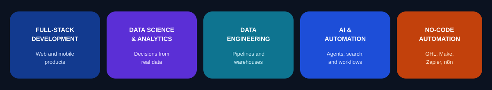

  

  

  
  
  

  

## Selected work

<table>
  <tr>
    <td width="33%">
      <a href="https://github.com/prodeveloperpy-hash/pakufi-website"><b>Pakufi website</b></a> 
      Next.js agency site
    </td>
    <td width="33%">
      <a href="https://github.com/prodeveloperpy-hash/pakufi-cms"><b>Pakufi CMS</b></a> 
      Headless content system
    </td>
    <td width="33%">
      <a href="https://github.com/prodeveloperpy-hash/pakufi-butikmusic"><b>Butik Music</b></a> 
      Artist booking space
    </td>
  </tr>
  <tr>
    <td>
      <a href="https://github.com/prodeveloperpy-hash/pakufi-analytics"><b>Pakufi analytics</b></a> 
      Self-hosted site analytics
    </td>
    <td>
      <a href="https://github.com/prodeveloperpy-hash/daftar-pdf"><b>Daftar</b></a> 
      Local PDF editor
    </td>
    <td>
      <a href="https://github.com/prodeveloperpy-hash/quizonline"><b>QuizOnline</b></a> 
      Student and teacher quizzes
    </td>
  </tr>
</table>

<a href="https://github.com/prodeveloperpy-hash?tab=repositories">All public repositories</a>

## Experience

**Senior Solution Architect, UpForge** · July 2026 – present  
SaaS, automation, and AI products, from the architecture through deployment.

**Backend Engineer, UpSurge** · June 2024 – July 2026  
Python, Django, FastAPI, and Node services in production.

**M.Sc. Computer Science**, Government College University Lahore · 2021

## Start a project

  <a href="mailto:mail.fiazhussain.dev@gmail.com"><b>mail.fiazhussain.dev@gmail.com</b></a> 
  Freelance builds, product work, and longer engineering support.

